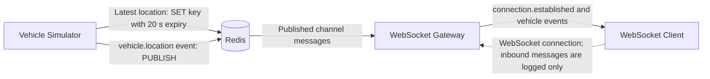
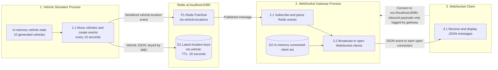
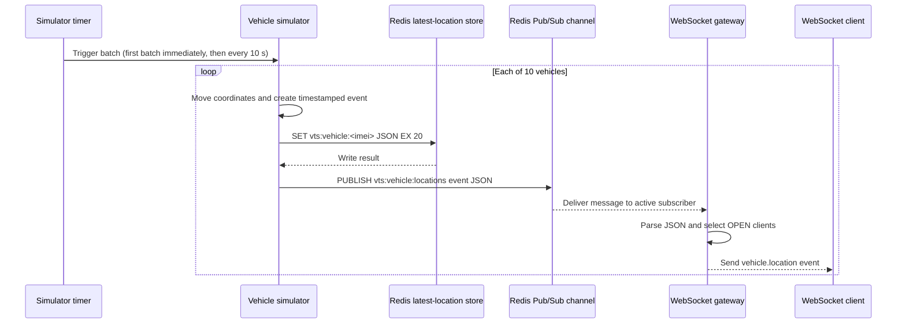

# VTS Simulator Architecture DFD

This document describes the current implementation in `simulator.js`, `websocket-server.js`, and `client.js`.

## Scope and Components

- **Vehicle simulator**: generates 10 synthetic vehicle locations, moves them every 10 seconds, and emits `vehicle.location` events.
- **Redis**: runs at `localhost:6380`; holds each vehicle's latest location under `vts:vehicle:<imei>` for 20 seconds and relays live events on `vts:vehicle:locations`.
- **WebSocket gateway**: subscribes to the Redis channel and broadcasts received events to connected WebSocket clients on port `8080`.
- **WebSocket client**: connects to `ws://localhost:8080` and displays received messages.

The simulator and gateway are separate Node.js processes. Redis is their shared integration point. The DFD reflects the current local-development configuration; it does not assume a browser, API server, authentication layer, or durable event store.

## Level 0: Context DFD



## Level 1: Process and Data-Store DFD



## Level 2: Vehicle-Location Event Flow



### Event and Storage Contracts

The published event has this shape:

```json
{
  "event": "vehicle.location",
  "data": {
    "imei": "35693803564001",
    "vehicleNumber": "MH12AB0001",
    "latitude": 18.5204,
    "longitude": 73.8567,
    "timestamp": "ISO-8601 timestamp"
  }
}
```

The Redis key stores only the `data` object, while Pub/Sub carries the full event envelope. The write to the latest-location key happens before publishing the event.

### Current Behavior and Boundaries

- Redis Pub/Sub is a live relay, not a durable queue: disconnected consumers do not receive missed events later.
- The gateway broadcasts events to every open client; there is no per-vehicle filtering or acknowledgement flow.
- The WebSocket client does not send application commands. Any inbound message is logged by the gateway only.
- The latest-location keys expire after 20 seconds. They are not read by the gateway or client in the current implementation.
- The simulator catches and logs processing errors per vehicle; the gateway catches malformed Redis messages. No retry, replay, or persistence beyond the expiring keys is implemented.
- The current configuration uses local Redis and an unencrypted `ws://` connection. Authentication and authorization are not implemented in these files.